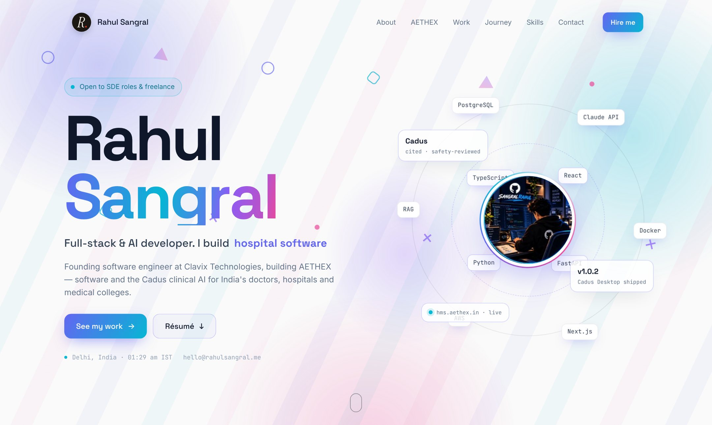
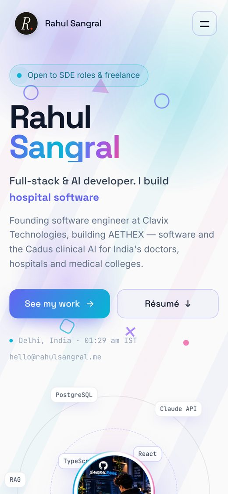

<div align="center">

# Rahul Sangral — Portfolio

**Full-stack & AI developer.** The source of [rahulsangral.me](https://rahulsangral.me), my personal site:
AETHEX, Cadus, Codexa and the rest of my work, with motion in every section.

[](https://rahulsangral.me)




</div>

---

## Highlights

- **Pre-rendered and fast.** The whole page is rendered to HTML when you build it, so the first screen shows before any JavaScript runs. The browser then hydrates it to switch on the interactive parts.
- **Small runtime.** It runs on Preact through `preact/compat`, so the code is ordinary React-style JSX. The script is about 20 KB gzipped.
- **Animated background in every section.** Drifting colour clouds, floating shapes, falling light beams, rising bubbles, code glyphs and waves. Each loop pauses while its section is off screen.
- **Certification arena.** One credential holds the centre while each of the others charges in from the left or right, collides with it and gets knocked out. It runs on the Web Animations API.
- **Interactive throughout:**
  - A letter-by-letter name reveal and a rotating role line.
  - A tech-stack orbit around the avatar and tech-logo marquees.
  - 3D tilt cards with a cursor spotlight, plus filterable projects.
  - A timeline that fills as you scroll, and counters with progress rings.
  - An auto-playing product screenshot viewer.
- **Live data.** GitHub repository and follower counts, and LeetCode stats. These are fetched only once the browser is idle, so they never delay the first paint.
- **Accessible.** Semantic landmarks, a skip link, visible focus states and keyboard-reachable links. All motion turns off under `prefers-reduced-motion`.

<p align="center"></p>

## Performance

Measured locally with a simulated fast-4G phone (40 ms latency, 9 Mbps, 2× CPU slowdown):

| Metric | Before | Now |
|---|---|---|
| Largest Contentful Paint | ~2.5 s | **~0.6 s** |
| Data on first load | ~320 KB | **~125 KB** |
| JavaScript (gzip) | 82 KB | **20 KB** |

How it gets there:

1. Build-time pre-rendering with `preact-render-to-string`, followed by hydration in the browser.
2. The stylesheet is inlined into the HTML, and the two first-screen fonts are preloaded.
3. Animations change only `transform` and `opacity`, and loops pause while off screen.
4. The first screen starts its animations at opacity 0.01, so it counts as painted on the first frame.
5. Third-party API calls wait until the page has loaded and the browser is idle.
6. Hashed assets are cached as immutable, and screenshots ship as WebP at 1× and 2×.

## Tech stack

| Area | Tools |
|---|---|
| UI | Preact 10 via `preact/compat` (React-style JSX), hand-written CSS |
| Build | Vite 7, `@vitejs/plugin-react` |
| Rendering | `preact-render-to-string` at build time, `hydrateRoot` in the browser |
| Motion | CSS keyframes, Web Animations API, IntersectionObserver |
| Fonts | Space Grotesk, Inter (variable) and JetBrains Mono, self-hosted with Fontsource |
| Hosting | Vercel, with caching and security headers set in `vercel.json` |

## Getting started

Requires **Node.js 18+**.

```bash
npm install
npm run dev       # local dev server at http://localhost:5173
npm run build     # production build plus pre-render, output in dist/
npm run preview   # serve the production build locally
```

`npm run build` runs `vite build` and then `node prerender.mjs`. The second step renders the page to HTML, injects it into `dist/index.html`, inlines the CSS and adds the font preloads.

## Project structure

```
├── index.html            # page shell: meta tags, Open Graph, JSON-LD
├── prerender.mjs         # build step: HTML pre-render, CSS inlining, font preloads
├── vite.config.js        # Preact aliasing for the live design
├── vercel.json           # rewrites, cache and security headers
├── public/
│   ├── brand/            # logo mark and avatar
│   ├── shots/            # product screenshots (WebP, 1x and 2x)
│   ├── tech/             # tech-stack logos (SVG)
│   ├── logos/ certs/     # issuer logos and certificate PDFs
│   └── resume.pdf
└── src/
    ├── main.jsx          # picks the live design and hydrates it
    ├── entry-server.jsx  # build-time render entry
    ├── data.js           # profile, experience, certifications, case studies
    ├── site/live.js      # GitHub and LeetCode live stats
    └── prism/            # the current design (App.jsx and prism.css)
```

Earlier designs (`nova`, `github`, `editorial` and others) are kept in their own folders under `src/`.

## Editing content

| What | Where |
|---|---|
| Name, email, résumé link, experience, certifications | `src/data.js` |
| Projects (Work section) | `WORK` in `src/prism/App.jsx` |
| AETHEX products and Cadus features | `PRODUCTS` and `CADUS` in `src/prism/App.jsx` |
| Skills, skill-depth bars, tech marquees | `SKILLS`, `DEPTH`, `MARQUEE_A` and `MARQUEE_B` in `src/prism/App.jsx` |
| Coding profiles | `PROFILES` in `src/prism/App.jsx` |
| Résumé | replace `public/resume.pdf` |
| Screenshots and logos | `public/shots/` and `public/tech/` |

To feature a project, add `featured: true` and an `img` to its `WORK` entry. It then gets the full-width card.

## Switching designs

`src/main.jsx` imports the live design:

```js
import App from './prism/App.jsx'   // change the folder, e.g. './nova/App.jsx'
```

The Preact runtime and the build-time pre-render are turned on automatically when the import points to `prism`. Older designs build with React.

## Deployment

The site deploys to **Vercel** automatically on every push to `main`. The framework preset is Vite, the build command is `npm run build` and the output directory is `dist`. All of this is already set in `vercel.json` and `package.json`.

## Contact

**Rahul Sangral**, full-stack & AI developer, Delhi, India

[rahulsangral.me](https://rahulsangral.me) · [hello@rahulsangral.me](mailto:hello@rahulsangral.me) · [GitHub](https://github.com/sangralrahul) · [LinkedIn](https://www.linkedin.com/in/rahulsangral/)

<sub>© Rahul Sangral. The code is shared for reference; the personal content, images and résumé are not licensed for reuse.</sub>
